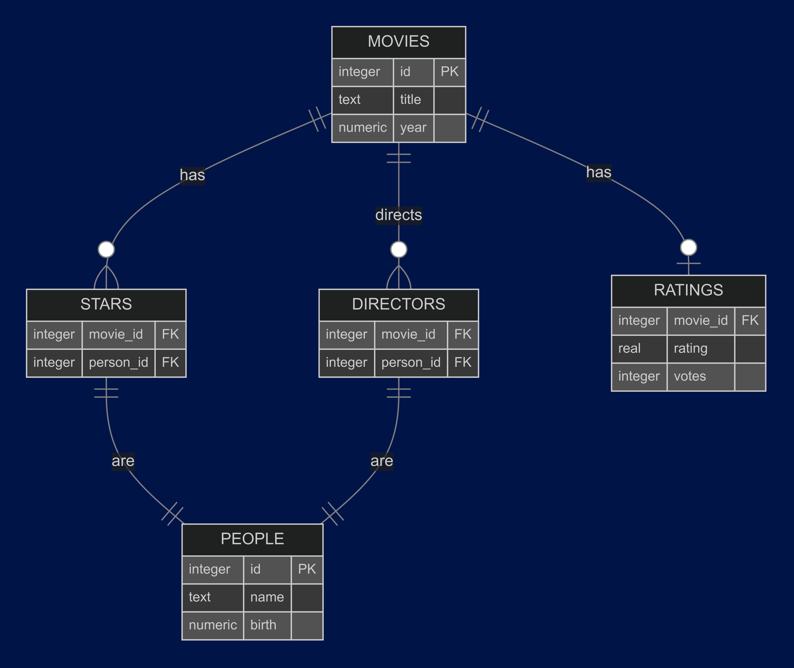

## COM1028 Software Engineering - FlickFinder

This project is a simple application that provides a RESTful API for accessing a movie database. The database is a simple SQLite database that contains information about movies, people, and their relationships.

## Dependencies

- [sqllite-jdbc](https://mvnrepository.com/artifact/org.xerial/sqlite-jdbc) - SQLite JDBC Driver
- [javalin](https://javalin.io/) - A web framework for Java
- [junit](https://junit.org/junit5/) - JUnit for unit testing
- [mockito](https://site.mockito.org/) - Mockito for mocking objects in unit tests
- [rest-assured](https://rest-assured.io/) - Testing and validating our APIs

These dependencies are managed by Maven, and you can find them in the [pom.xml](pom.xml) file.

## Database

### Development Database

The database is a simple SQLite database that contains information about movies, people, and their relationships. The database is structured as follows:

